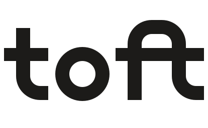
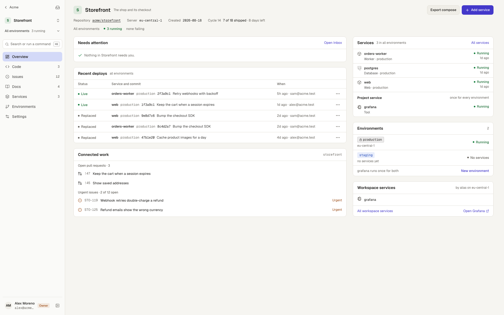
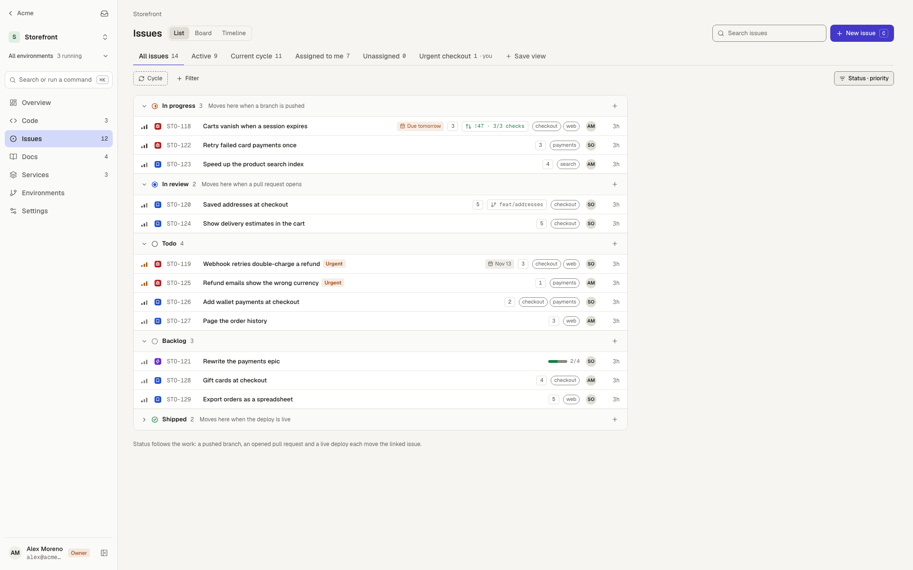
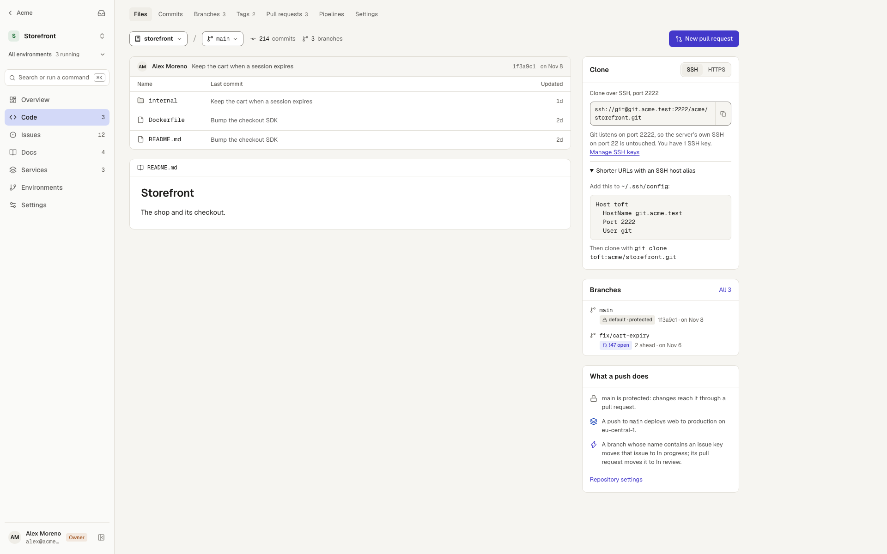

<div align="center">

<picture>
  <source media="(prefers-color-scheme: dark)" srcset="docs/brand/wordmark/toft-wordmark-white.svg">
  
</picture>

### Deploys, code, issues and docs, on servers you own.

Toft is an open-source, self-hosted platform built around your project. Push
code, review it, track the work, write the runbook and ship it, all in one
place, on your own machines.

[](https://github.com/Nickpap21/toft/actions/workflows/ci.yml)
[](https://github.com/Nickpap21/toft/releases)
[](LICENSE)
[](backend/go.mod)
[](https://github.com/Nickpap21/toft/discussions)

[**Docs**](https://nickpap21.github.io/toft/) ·
[**Install**](#install) ·
[**Roadmap**](ROADMAP.md) ·
[**Changelog**](CHANGELOG.md) ·
[**Contributing**](CONTRIBUTING.md)

<br>

<picture>
  <source media="(prefers-color-scheme: dark)" srcset=".github/assets/deploys-dark.png">
  
</picture>

</div>

## What Toft is for

Most teams that self-host run four tools side by side: a PaaS, a git host, an
issue tracker and a wiki. Toft is one install that does all four, with the
**project** at the centre. A push opens a pull request, the pull request gets
a preview, the issue moves when the pull request opens, the deploy links back
to all of it, and the runbook sits next to the service it's for.

**No lock-in, no single point of failure.** Every server runs its own Traefik
and keeps serving its apps when the panel is down. Your apps are plain Docker
containers on servers you control, one server or many.

Toft isn't Kubernetes, and doesn't run on it
([why](https://nickpap21.github.io/toft/decisions/docker-not-kubernetes/)).

## Proof

### How it compares

Toft, Coolify and Dokploy, each on its own fresh Hetzner Cloud `cx23`
(2 vCPU, 4 GB, Ubuntu 24.04), deploying the same app from its image and
from its source. Median of three rounds, range in brackets. The method, the
scripts to rerun it and every reading are in [`bench/`](bench/).

| | Coolify 4.5.3 | Dokploy v0.30.10 | Toft v0.29.0 |
|---|---|---|---|
| Install (s) | 139.8 (136.5–141) | 225.8 (217.9–232.8) | 105.5 (96.8–110.2) |
| Idle memory (MiB) | 682 (670–686) | 1038 (1027–1043) | 398 (385–400) |
| Idle CPU (% of 2 vCPU) | 12 (11.1–12.3) | 1.2 (1–1.6) | 1.8 (1.8–1.9) |
| Disk (MiB) | 3195 (3195–3195) | 5031 (5031–5033) | 2271 (2271–2380) |
| First deploy, image (s) | 10.4 (10.3–12.2) | 5.8 (5.8–6) | 5.8 (5.8–6.6) |
| First deploy, build (s) | 75.8 (74–78.1) | 63 (62.8–67.2) | 78.7 (73.2–82.9) |
| Redeploy, image (s) | 11.5 (8.7–15.3) | 6.4 (5.8–6.7) | 4.9 (4.1–7.7) |
| Redeploy, build (s) | 12.6 (9.9–24) | 57 (55.2–98.2) | 6.4 (4.4–13.4)¹ |
| Seconds with failed requests per redeploy | 3 (3–4) | 0 | 0 |
| Dashboard load (ms) | 803.5 (717–1026) | 339 (315–533) | 282 (205–615) |
| Dashboard largest paint (ms) | 828 (744–1044) | 444 (416–636) | 436 (332–764) |
| Dashboard transfer (KiB) | 3361 (3359–3361) | 1519 (1518–1568) | 446 (443–449) |
| Dashboard requests | 18 (17–18) | 118 (118–118) | 40 (37–44) |

¹ Toft v0.30, measured 2026-10-30, after git builds stopped putting `.git`
in the build context; v0.29.0 rebuilt the same commit in 63 s. The servers
were slower that day (install and first build took about 20 % longer), so
the other rows stay v0.29.0's, measured 2026-10-29 and 30 alongside Coolify
and Dokploy. A redeploy is the same commit again; failed seconds are
counted over 15 image and 15 build redeploys per platform.

### Security

Each claim links the decision behind it and the guide that shows it working.

| | Decision | Guide |
| --- | --- | --- |
| **gVisor sandboxing.** A service runs Standard, Sandboxed (gVisor), or Sandboxed with a strict network. | [Isolation levels](https://nickpap21.github.io/toft/decisions/isolation-levels/) | [Isolation](https://nickpap21.github.io/toft/reference/isolation/) |
| **A firewall on every server.** App containers reach their own host only on web ports and DNS, and never the cloud's metadata address. | [Host firewall](https://nickpap21.github.io/toft/decisions/host-firewall/) | [The host firewall](https://nickpap21.github.io/toft/guide/servers/#the-host-firewall) |
| **Signed agent releases.** The agent installs only a release whose signature covers its version, architecture and hash. | [The node agent](https://nickpap21.github.io/toft/decisions/node-agent/) | [Signed releases](https://nickpap21.github.io/toft/guide/servers/#signed-releases-and-upgrades) |
| **Write-once secrets, bound to their place.** Nobody can read a secret back, and an encrypted value copied to another row doesn't open. | [Write-once secrets](https://nickpap21.github.io/toft/decisions/write-once-secrets/) | [Variables and secrets](https://nickpap21.github.io/toft/guide/deploys/#variables-and-secrets) |
| **Deploy policies.** A policy limits what a service may mount or reach. An exception is pinned to the values it approved: change one and the deploy is refused until it's granted again. | | [Deploy policy](https://nickpap21.github.io/toft/guide/deploys/#deploy-policy) |
| **Scoped keys that expire.** A key can be limited to one project and chosen scopes, and every key expires after 90 days unless you choose otherwise. | | [Expiry](https://nickpap21.github.io/toft/reference/cli/#expiry) |
| **Agent approvals.** Each AI agent action runs, waits for a person, or is refused, with its own setting for previews, other environments and protected ones. Deploys to `production` wait by default. | [Agent policy](https://nickpap21.github.io/toft/decisions/agent-policy/) | [The agent policy](https://nickpap21.github.io/toft/reference/mcp/#the-agent-policy) |

Toft had a full security audit before launch, then a second one after the
fixes. Nothing Medium or above is open. Please report vulnerabilities
privately, never in a public issue: see [SECURITY.md](SECURITY.md).

## How it works

```
            you: browser · toft CLI · git · AI agents (MCP)
                                 │
               ┌─────────────────▼─────────────────┐
               │  Toft panel                       │
               │  Go API · Next.js · Postgres · git│
               └─────────┬─────────────────┬───────┘
                    SSH  │                 │  outbound agent
               ┌─────────▼──────┐   ┌──────▼─────────┐
               │  server        │   │  server        │
               │  Traefik       │   │  Traefik       │
               │  your apps     │   │  your apps     │
               └────────────────┘   └────────────────┘
```
Each server runs its own Traefik, so a server keeps serving its apps when the
panel is down. Read more in the [architecture guide](https://nickpap21.github.io/toft/architecture/).

### What's in it

<table>
<tr>
<td width="50%" valign="top">

### 🚀 Deploy
- Deploy from **git**, a **Docker image** or a **Compose** file
- **Deploy on push**, from a Toft repository or from **GitHub** through a webhook
- **Blue/green** switches after the health check, and rollback in one click
- **Preview environments** for every pull request
- Live deploy logs, per-service metrics and alerts
- Custom domains with automatic **Let's Encrypt**, including wildcards

</td>
<td width="50%" valign="top">

### 🖥️ Servers
- Add servers over **SSH** or with a small outbound **agent**
- One-click provisioning: Docker, firewall, Traefik
- Capacity per server, and shared servers across workspaces
- Pending updates and what fills the disk, with installs, reboots and cleans
- Encrypted nightly **backups** to S3, and a recovery kit to restore the panel

</td>
</tr>
<tr>
<td valign="top">

### 🌿 Code
- **Git hosting** over SSH and HTTPS
- Pull requests with reviews, checks and merge
- Pipelines, mirrors to and from other hosts, outbound webhooks
- A protected default branch

</td>
<td valign="top">

### 📋 Issues and docs
- Issues with list, board and timeline views
- Cycles, estimates, epics, releases and blockers
- Issues that move when a branch is pushed or a pull request opens
- Project **docs and runbooks**, whose steps run in the service's container

</td>
</tr>
<tr>
<td valign="top">

### 👥 Teams
- Workspaces with Owner, Developer and Viewer roles
- Invite-only sign-up, with links that work once
- An audit log
- Three isolation levels per service (see [Security](#security))

</td>
<td valign="top">

### 🤖 Agents
- A built-in **MCP server**, so Claude Code and other agents can deploy,
  read logs, open pull requests and work issues
- A workspace agent policy: allow, ask a person, or never
- Scoped API keys, the `toft` CLI and an OpenAPI API

</td>
</tr>
</table>

<div align="center">
<table>
<tr>
<td width="50%">
<picture>
  <source media="(prefers-color-scheme: dark)" srcset=".github/assets/issues-dark.png">
  
</picture>
</td>
<td width="50%">
<picture>
  <source media="(prefers-color-scheme: dark)" srcset=".github/assets/code-dark.png">
  
</picture>
</td>
</tr>
</table>
</div>

## First use

### Install

On a fresh Linux server:

```sh
curl -fsSL https://github.com/Nickpap21/toft/releases/latest/download/install.sh | sudo sh
```

The installer checks the server, installs Docker if it's missing, starts
Toft and prints a one-time **setup code**.

| Requirement | |
| --- | --- |
| OS | Ubuntu 22.04+, Debian 12+, Rocky Linux or AlmaLinux 9+ |
| CPU | amd64 or arm64 |
| Size | 2 vCPU and 4 GB RAM to run apps beside the panel; less runs the panel only |
| Ports | 80 and 443, plus 2222 for git over SSH |

### Your first deploy

1. Open the address the installer printed (your browser warns about its
   self-signed certificate until the panel has a domain), enter the
   **Setup code** and create your account. At **This server**, choose
   **Run apps here too** so apps can run on this server, then store the
   **Recovery kit**.
2. On **Home**, under **Deploy your first app**, choose **An image**. It goes in
   a new project named after it.
3. Set **Image** to `traefik/whoami` and **Port** to `80`, then choose **Create
   and deploy**. Toft pulls the image, starts it and switches traffic. It
   answers at once on a temporary address under `sslip.io`.
4. To give it your own domain, open the service's **Settings**, choose **Add
   domain** under **Domains** and enter a name you own, such as
   `whoami.example.com`. Point its `A` record at the server, then choose **Add
   and deploy** and confirm (`production` is protected). Toft gets a Let's
   Encrypt certificate. Open `https://whoami.example.com`.

From there: [deploy from git](https://nickpap21.github.io/toft/guide/deploys/#git),
[add servers](https://nickpap21.github.io/toft/guide/servers/) and [set up backups](https://nickpap21.github.io/toft/guide/backups/).

Upgrades run from **Instance → Overview** in the panel, or with
`toft upgrade --to <version>`. See the [install guide](https://nickpap21.github.io/toft/install/)
for domains, options and restoring from a backup.

## Built with AI, reviewed by people

Toft is built with heavy AI assistance. Much of the code is written with
coding agents, then reviewed, tested and signed off by its maintainers. Every
change passes the same CI gate: linting, static analysis, the race detector,
vulnerability checks and the full test suite. [`AGENTS.md`](AGENTS.md) holds the rules agents follow here.
AI-assisted contributions are welcome on the same terms as any other
([CONTRIBUTING.md](CONTRIBUTING.md#ai-assisted-contributions)).

## Contributing

Bug reports, ideas and pull requests are welcome.

- Read [CONTRIBUTING.md](CONTRIBUTING.md) for the local setup and the checks.
- Ask questions in [Discussions](https://github.com/Nickpap21/toft/discussions).
- Look for issues labelled
  [good first issue](https://github.com/Nickpap21/toft/labels/good%20first%20issue).

Everyone taking part follows the [Code of Conduct](CODE_OF_CONDUCT.md).

## License

Toft is licensed under [AGPL-3.0-or-later](LICENSE). The CLI, SDKs and API
schemas will be Apache-2.0 once they're in their own directories
([details](CONTRIBUTING.md#licensing)). "Toft" and its logo are trademarks of
the project, not covered by the licence.
